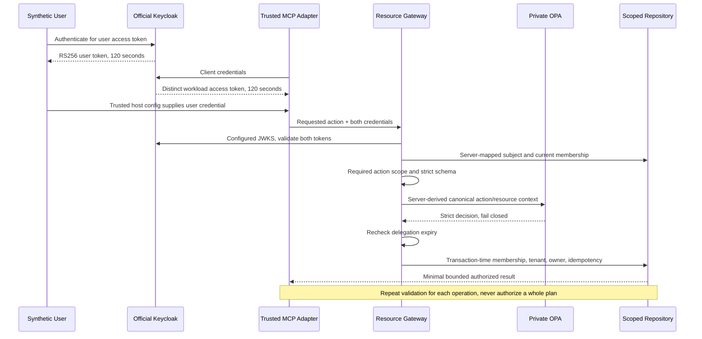

# PRD 05: Identity Propagation and Delegated Authority

Container-verified local reference implementation. This folder owns only PRD 05: the identity gateway, official Keycloak realm configuration, stdio credential relay and identity tests. Business services, tool schemas, bounded MCP middleware, repository and read/write policies come from explicit PRD 01-04 image dependencies; their source is not copied here.

## Run and Verify

From this folder, with Docker running and Python 3 available:

```bash
bash scripts/check.sh
bash scripts/run.sh
docker compose --profile tools run --rm --no-deps smoke
docker compose down
```

The check script builds/checks prerequisite projects first. The run script expects those images to exist. Gateway: <http://127.0.0.1:8225/docs>. Official Keycloak: <http://localhost:8425>. Ports/subnet can be overridden with the variables in [.env.example](.env.example). Keycloak uses standard `dev-file` in its disposable writable container layer, without a persistent volume; replacing the container imports the fixture realm again. This fixes an observed empty H2 session-table failure with `dev-mem`. Real issuance after recreation and the PRD 07 restart regression pass; precise long-idle reproduction remains unverified. Gateway SQLite is also volatile and single-process. Cleanup affects only Compose project `zero-trust-identity-delegation`.

`scripts/setup_env.py` generates local synthetic fixture passwords and client secrets in an ignored `.env` with mode 0600, retaining an existing file. It never prints the values. Do not use real accounts/secrets for this workshop or put bearer tokens in commands, logs, screenshots or source control. The Docker build context excludes `.env`.

## Chosen Identity Model

Validated OAuth access-token propagation through a resource-owning trusted gateway, not token exchange. The user and agent adapter present distinct standard RS256 bearer tokens. The gateway independently validates each token on **every delegated call** using PyJWT and the configured Keycloak JWKS endpoint. It validates signature, fixed issuer/audience/client, expiry, issued-at, subject, token type, token ID, scopes and a maximum 300-second lifetime. The realm issues 120-second tokens. Unverified JWT headers select a signing key only; they never establish authority or select a caller-provided key URL. JWKS responses are bounded; unavailable/malformed keys fail closed.

| Identity | Source | Authority |
| --- | --- | --- |
| Human | Keycloak `learning-client`, audience `learning-gateway` | Subject-to-learner mapping configured on the server; current active membership in the inherited SQLite repository |
| Workload | Keycloak client credentials for `agent-adapter`, audience `learning-gateway-workload`, scope `tools.invoke` | Permits an adapter to present a user context; grants no learner, tenant or write permission |
| Delegation | Intersection of valid user action scope, active membership, tool schema, OPA decision and repository ownership | Only the requested canonical action on the user's owned resources |

The gateway rejects known caller-supplied user/tenant/role/owner/workload identity headers rather than trusting them. Signed token tenant claims are ignored. An unknown user subject is rejected; a known subject's tenant is resolved from server-owned fixtures and current membership, not token metadata. The repository checks current membership and ownership again inside the protected transaction. The inherited OPA workload field remains the prior service context; it is **not** evidence of SPIFFE/mTLS identity. PRD 06 owns transport workload identity.

Direct inherited read endpoints require a validated user token and the read action's scope. Delegated tool endpoints additionally require a workload token via `X-Workload-Authorization`; that header is a credential, not an asserted identity. MCP tool arguments contain neither credentials nor identity. The relay gets both tokens only from trusted process configuration and obtains its principal from the authenticated gateway context; it forwards tokens for validation again on every operation. It exposes the same four strict tools and inherits PRD 04's input/output/time/concurrency/call budgets. Gateway calls independently bound body/output to 1024/4096 bytes and execution to two seconds.



## Expiry, Revocation and Missing Context

Expired, future-issued, malformed, wrong-client/audience/signature, missing-subject and unknown-subject tokens return safe 401 errors. Missing user or workload context fails closed. Missing scope returns 403. Committed membership revocation blocks the next sensitive operation even if both access tokens are still valid. Expiry after OPA evaluation is rechecked before protected delegated access/write. Foreign resource targets return safe 404 with no protected output or effect.

Self-contained JWT validation does **not** make Keycloak logout or client disabling immediately revoke an already issued token. That revocation delay is bounded by remaining token lifetime (120 seconds in this realm), unless signing keys or authoritative membership are removed sooner. No introspection, per-token denylist, refresh loop or token exchange is implemented. The stdio process does not refresh credentials: after expiry, obtain fresh tokens through the trusted client flow and start a new session. Membership revocation tests use the repository's trusted test hook, not a public administrative endpoint.

## Actual Verification, 2026-10-11

`bash scripts/check.sh` passed after correcting packaged Ruff configuration naming. The container gate passed lint, format, strict mypy (four identity files), **22 identity tests + 77 inherited Python tests**, **21 Rego tests**, and the inherited tenant-condition mutation rejection. Negative tests cover spoofed headers, expired/wrong-audience/missing-subject/invalid-signature tokens, unknown tenants, insufficient scope, distinct identities, a valid workload acting for an unauthorized user, revoked membership between steps, in-flight expiry, JWKS failures and zero unauthorized side effects. Token values do not appear in captured gateway logs/errors.

Real official Keycloak issued both credential types. Actual HTTP and official SDK subprocess stdio checks passed all four tools, duplicate-write retries, foreign-resource denial, user/workload audience separation, signature rejection and spoofed headers. Provider integration initially revealed a missing user `sub`; adding Keycloak's standard subject mapper fixed issuance without weakening the verifier. Runtime inspection: Python 3.12.11, UID 10001, PyJWT 2.15.1, cryptography 50.0.2, MCP 2.3.0, HTTPX 0.28.1. Keycloak 26.0.7 and OPA 1.21.1 are official digest-pinned images. No custom cryptography/IdP, real learner data, LLM, Istio, SBOM, vulnerability scan or signing claim is made.

## Trust Assumptions and Remaining Risks

Keycloak `start-dev`, volatile database, plain HTTP and password grant are local automated-fixture conveniences, **not production recommendations**. Production requires an updated/scanned supported IdP release, TLS, durable account/membership storage, authorization-code plus PKCE for users, workload/mesh identity, external secret handling and a stated revocation SLA. The confidential client secret is a local workload credential, not hardware-backed or SPIFFE identity. A compromised trusted adapter can misuse its user's token within that user's remaining scopes/lifetime; it cannot gain another tenant's authority. Docker networking is not a mesh security boundary. JWT/JWKS caches are deliberately absent; issuer outage denies new calls. PRDs 06-10 own the remaining controls.

Rollback: stop this project and use the separately documented PRD 04 project for its **demo-only** stdio behavior. Never replace production token validation with the old demo credential mapping. Recreating the PRD 05 gateway resets volatile progress/evidence fixtures; no durable recovery guarantee is claimed.